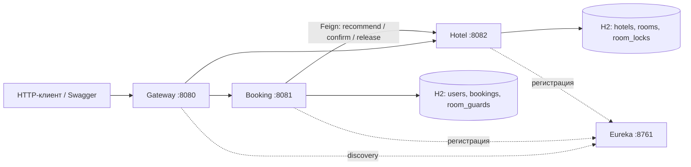

# Система бронирования номеров в отеле

## Stack

Java 21, Maven, Spring Boot 3, Spring Cloud, Spring MVC,
Spring Data JPA, H2, Spring Security OAuth2, JWT,
OpenFeign, Spring Retry, Resilience4j, Lombok, MapStruct, Swagger.



| Модуль | Назначение | Порт |
|---|---|---|
| `eureka-service` | Регистрация и обнаружение сервисов | 8761 |
| `hotel-service` | Отели, номера, рекомендации, статистика, блокировки дат | 8082 |
| `booking-service` | Пользователи, выдача JWT, история и сага бронирования | 8081 |
| `gateway-service` | Проверка JWT, маршрутизация, CORS, корреляция | 8080 |

## Quick start

Из корня репозитория:

```shell
mvn clean verify
```

Микросервисы запускать в указанном порядке: eureka -> hotel -> booking -> gateway

```shell
java -jar eureka-service/target/eureka-service-0.0.1-SNAPSHOT.jar
java -jar hotel-service/target/hotel-service-0.0.1-SNAPSHOT.jar
java -jar booking-service/target/booking-service-0.0.1-SNAPSHOT.jar
java -jar gateway-service/target/gateway-service-0.0.1-SNAPSHOT.jar
```

Либо: `mvn -pl hotel-service spring-boot:run` и аналогично для остальных модулей.

Дождаться регистрации сервисов со статусом UP на [Eureka](http://localhost:8761).
Health checks: `http://localhost:<порт>/actuator/health`.

- [Swagger Booking](http://localhost:8081/swagger-ui/index.html)
- [Swagger Hotel](http://localhost:8082/swagger-ui/index.html)

В Swagger нажать **Authorize** и вставить значение `token` из ответа `/user/auth`.
Основной публичный вход для запросов - `http://localhost:8080`.

### Environment

| Переменная окружения | По умолчанию | Где используется |
|---|---|---|
| `JWT_SECRET` | ключ из `application.yaml` | Одинаковый в booking, hotel, gateway |
| `ADMIN_USERNAME` / `ADMIN_PASSWORD` | `admin` / `admin123` | Создание ADMIN при старте booking |
| `DEMO_USERNAME` / `DEMO_PASSWORD` | `user` / `user123` | Создание USER при старте booking |

После изменения переменных перезапустить приложения:
`$env:JWT_SECRET = 'your-shared-secret-of-at-least-32-bytes'` в каждом из трёх терминалов.
Порты можно менять через `--server.port=...`, адрес Eureka - через
`--eureka.client.service-url.defaultZone=http://localhost:8761/eureka/`.

Hotel создаёт 3 отеля и 5 номеров: 4 доступны, один на ремонте; счётчики бронирований
различаются для демонстрации рекомендаций.
Первый номер: `aaaaaaaa-0000-0000-0000-000000000101`, отель `11111111-1111-1111-1111-111111111111`.
Брони создаются через API, чтобы демонстрационные данные проходили настоящую сагу.

## Demo

Команды работают после запуска всех микросервисов.

```powershell
$base = 'http://localhost:8080'
$auth = Invoke-RestMethod "$base/user/auth" -Method Post -ContentType 'application/json' `
    -Body '{"username":"user","password":"user123"}'
$headers = @{ Authorization = "Bearer $($auth.token)"; 'X-Request-Id' = [guid]::NewGuid().ToString() }
Invoke-RestMethod "$base/api/hotels" -Headers $headers
Invoke-RestMethod "$base/api/rooms/recommend" -Headers $headers
$body = @{
    autoSelect = $true
    hotelId = '11111111-1111-1111-1111-111111111111'
    startDate = (Get-Date).AddDays(10).ToString('yyyy-MM-dd')
    endDate = (Get-Date).AddDays(12).ToString('yyyy-MM-dd')
    requestId = [guid]::NewGuid().ToString()
} | ConvertTo-Json
$booking = Invoke-RestMethod "$base/booking" -Method Post -Headers $headers `
    -ContentType 'application/json' -Body $body
$booking
# Повтор того же тела вернёт тот же id, не создавая новую бронь.
Invoke-RestMethod "$base/booking" -Method Post -Headers $headers -ContentType 'application/json' -Body $body
Invoke-RestMethod "$base/bookings?page=0&size=10" -Headers $headers
Invoke-RestMethod "$base/booking/$($booking.id)" -Method Delete -Headers $headers
Invoke-RestMethod "$base/booking/$($booking.id)" -Headers $headers
```

Вызов авторизации через curl (в PowerShell - `curl.exe`):

```shell
curl -X POST http://localhost:8080/user/auth -H "Content-Type: application/json" -d '{"username":"user","password":"user123"}'
```

## API

Во всех защищённых запросах: `Authorization: Bearer <token>`.
JWT пользователя действует 1 час; регистрация всегда создаёт USER.
ADMIN также может бронировать. Чужие брони доступны для чтения/отмены только ADMIN;
`GET /bookings` всегда возвращает историю текущего пользователя.

| Метод и путь | Доступ | Тело / параметры |
|---|---|---|
| `POST /user/register` | Публичный | `{username,password}` → JWT, 201 |
| `POST /user/auth` | Публичный | `{username,password}` → JWT, 200 |
| `GET /user` | ADMIN | Список пользователей без паролей |
| `POST /user` | ADMIN | `{username,password,role}`; роль USER или ADMIN |
| `PATCH /user` | ADMIN | `{id,username?,password?,role?}` |
| `DELETE /user?id={uuid}` | ADMIN | 204 |
| `POST /booking` | USER / ADMIN | См. ниже; 201 |
| `GET /bookings?page=0&size=10` | USER / ADMIN | `content,page,size,totalElements,totalPages` |
| `GET /booking/{id}` | Владелец / ADMIN | Одна бронь |
| `DELETE /booking/{id}` | Владелец / ADMIN | Отмена и освобождение номера; 204 |
| `GET /api/hotels` | USER / ADMIN | Фильтры `name`, `address`; `sort=name,asc` |
| `GET /api/hotels/{id}` | USER / ADMIN | Отель с номерами |
| `POST /api/hotels` | ADMIN | `{name,address}`; 201 |
| `PUT /api/hotels/{id}` | ADMIN | `{name,address}` |
| `DELETE /api/hotels/{id}` | ADMIN | Удаление отеля и номеров; 204 |
| `GET /api/hotels/{id}/stats` | ADMIN | Количество номеров, операционно доступных номеров, сумма `timesBooked` |
| `GET /api/rooms` | USER / ADMIN | Операционно доступные номера; `hotelId`, `sort=number,asc` |
| `GET /api/rooms/recommend` | USER / ADMIN | Доступные номера по `timesBooked ASC, id ASC` |
| `GET /api/rooms/{id}` | USER / ADMIN | Номер |
| `POST /api/rooms` | ADMIN | `{hotelId,number,available?}`; 201 |
| `PUT /api/rooms/{id}` | ADMIN | `{number?,available?}` |
| `DELETE /api/rooms/{id}` | ADMIN | 204 |
| `GET /api/rooms/stats` | ADMIN | Все номера со статусами и счётчиками; `sort` |

Удаление номера или отеля с активными блокировками бронирований возвращает 409; сначала нужно отменить связанные брони.

Тело создания брони:

```json
{
  "hotelId": "11111111-1111-1111-1111-111111111111",
  "roomId": "aaaaaaaa-0000-0000-0000-000000000101",
  "startDate": "2027-01-10",
  "endDate": "2027-01-12",
  "autoSelect": false,
  "requestId": "dddddddd-0000-0000-0000-000000000001"
}
```

### Saga

1. Booking фиксирует `PENDING` в локальной транзакции. Проверка занятости по датам
   и вставка защищены строкой `room_guards`; одинаковые запросы пользователя сериализуются.
2. После коммита Feign Client вызывает Hotel, который блокирует номер, проверяет пересечения,
   создаёт `room_locks` и увеличивает `timesBooked` один раз.
3. Успешно -> `CONFIRMED`. Ошибка -> `CANCELLED` и компенсирующий release.
4. Если release не прошёл, `releasePending` остаётся в бд. Фоновая задача повторяет
   компенсацию каждые 10 секунд (`app.compensation.delay`, миллисекунды).
   Она не использует CircuitBreaker подтверждения. Ответ 204 -> отмена сохранена; освобождение в недоступном Hotel завершится после восстановления.
5. Hotel сохраняет маркер освобождения: поздний confirm той же брони получает 409.


## Tests

```shell
mvn test
mvn -pl booking-service test
mvn -pl hotel-service test
mvn clean verify
```